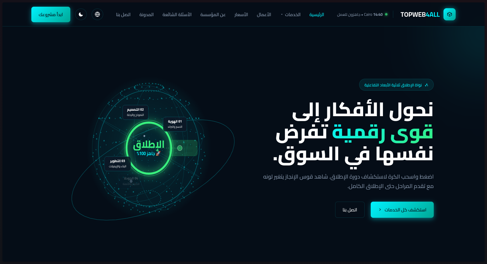

# TOPWEB4ALL — Software Engineering & Digital Brand Studio

> **Demo version:** هذه النسخة للعرض (Static Demo) على GitHub Pages. الموقع الأصلي يعمل بـ **WordPress** على الرابط الأساسي: **https://topweb4all.dev/**
>
> **Demo version:** This is a static demo. The production site runs on **WordPress** at **https://topweb4all.dev/** — all canonical / OG / sitemap URLs in this demo intentionally point to the production domain so Google indexes the original, not the demo.

موقع استوديو ثابت (Static) عربي / English، يعمل على **GitHub Pages** بدون سيرفر أو قاعدة بيانات. يشمل الموقع الرئيسي + أرشيف مشاريع ومقالات + صفحات دراسة حالة + لوحة توليد محتوى.

Static Arabic/English studio website that runs on **GitHub Pages** with zero backend. Content is managed from two JS files only.

## Screenshot



## Live Demo

بعد النشر على GitHub Pages:

`https://USERNAME.github.io/REPO/Topweb4all.html`

> ملاحظة: الصفحة الرئيسية حاليا باسم `Topweb4all.html`، وملف `index.html` نسخة مطابقة منها ليعمل الموقع مباشرة على `https://USERNAME.github.io/REPO/`.

## Features | المميزات

- عربي / English بتبديل فوري + وضع ليلي / نهاري محفوظ في `localStorage`
- أقسام: خدمات، أعمال، أسعار، المؤسِّسة، أسئلة شائعة، مدونة، تواصل
- أرشيف مشاريع `projects.html` بفلترة + صفحة دراسة حالة `project.html?id=SLUG`
- أرشيف مقالات `articles.html` ببحث وفلترة + صفحة مقال `article.html?id=SLUG`
- لوحة `admin.html` لتوليد كود مقال / مشروع جديد في دقيقتين (غير مفهرسة `noindex`)
- SEO كامل: title / description / canonical / Open Graph / Twitter لكل صفحة + JSON-LD (`ProfessionalService` + `BlogPosting` + `CreativeWork`) + `sitemap.xml` + `robots.txt` + صفحة `404`
- Accessibility: skip link، `focus-visible`، `landmarks`، `aria-current` و`aria-expanded`، دعم `prefers-reduced-motion` و`forced-colors`
- أداء: CSS/JS مشترك، أبعاد صور ثابتة لمنع CLS، fallback بدون JavaScript

## Technologies | التقنيات

- HTML5 + CSS3 + JavaScript (Vanilla — بدون build)
- `assets/chrome.css` + `assets/chrome.js` — الهيدر والفوتر الموحد لكل الصفحات
- `data/articles.js` + `data/projects.js` — مصدر كل المحتوى (AR + EN)
- WordPress Block Theme جاهز في `tw4a-theme/` (اختياري)

## Project Structure | هيكل الملفات

```text
Topweb4all/
├── index.html            # نسخة الدخول لـ GitHub Pages (مطابقة لـ Topweb4all.html)
├── Topweb4all.html       # الموقع الرئيسي
├── projects.html         # أرشيف المشاريع
├── project.html          # دراسة حالة مشروع (?id=SLUG)
├── articles.html         # أرشيف المقالات
├── article.html          # صفحة مقال (?id=SLUG)
├── admin.html            # لوحة توليد المحتوى (لا تنشرها مفهرسة)
├── 404.html
├── assets/
│   ├── chrome.css        # الهيدر / الفوتر / المنيو الموحد
│   └── chrome.js         # نفس الهيدر والفوتر + اللغة + الثيم (عدل الفوتر هنا مرة واحدة)
├── data/
│   ├── articles.js
│   └── projects.js
├── images/
│   ├── articles/
│   ├── projects/
│   └── og-cover.jpg
├── founder-omnia.jpg
├── Screenshot.png        # صورة المعاينة المستخدمة في README
├── favicon.ico / favicon.svg / favicon-16x16.png / favicon-32x32.png
├── apple-touch-icon.png / site.webmanifest
├── robots.txt / sitemap.xml
├── README.md / README-CONTENT.md / WORDPRESS-PLAN.md
└── tw4a-theme/           # نسخة ووردبريس (Block Theme) — اختياري للرفع
```

## How to Run Locally | التشغيل محليا

لا يحتاج build. الأفضل سيرفر بسيط عشان المسارات النسبية:

```bash
python3 -m http.server 8080
# افتح http://localhost:8080/Topweb4all.html
```

## How to Add Content | إضافة مقال أو مشروع (بدون كود)

1. افتح `admin.html` → املأ الحقول (عربي + إنجليزي) → **توليد الكود** → **نسخ**.
2. الصق الكود في `data/articles.js` أو `data/projects.js` قبل سطر القالب الأخير.
3. ضع الصورة في `images/articles/` أو `images/projects/` واكتب مسارها النسبي مثل `images/articles/my-post.jpg`.
4. ارفع الملفات — يظهر المحتوى تلقائيا في الرئيسية والأرشيف.

التفاصيل الكاملة في [README-CONTENT.md](README-CONTENT.md).

## Deploy to GitHub Pages | النشر

1. ارفع كل الملفات إلى المستودع (`git push`).
2. Settings → Pages → Source: **Deploy from a branch** → Branch: `main` → Folder: `/ (root)`.
3. الموقع يعمل على `https://USERNAME.github.io/REPO/`.

### مهم قبل النشر: رابط الموقع (canonical)

الروابط الأساسية مكتوبة حاليا على `https://topweb4all.dev/` في:

- `Topweb4all.html` و`index.html` (canonical + OG + JSON-LD)
- `articles.html`, `article.html`, `projects.html`, `project.html`
- `sitemap.xml`, `robots.txt`

لو ستنشر على GitHub Pages أو دومين مختلف، استبدل `https://topweb4all.dev` برابطك الفعلي في هذه الملفات.

## What to Upload to GitHub | ما الذي ترفعه وما الذي تستبعده

**ارفع:**

- كل ملفات `*.html` في الجذر (`index.html`, `Topweb4all.html`, `projects.html`, `project.html`, `articles.html`, `article.html`, `admin.html`, `404.html`)
- مجلدات `assets/` و`data/` و`images/` كاملة
- `Screenshot.png`, `founder-omnia.jpg`, ملفات favicon و`site.webmanifest`
- `robots.txt`, `sitemap.xml`
- `README.md`, `README-CONTENT.md`
- `tw4a-theme/` لو تريد نسخة الووردبريس (اختياري)

**لا ترفع (موجودة في `.gitignore`):**

- `tw4a-theme.zip` (نسخة مضغوطة مكررة)
- `wp-content-import/`, `wp-theme-prep/`, `tools/` إلا لو تحتاجها (أدوات تطوير فقط)
- ملفات النظام: `.DS_Store`, `Thumbs.db`, `*.log`, `node_modules/`, `.vscode/`, `.idea/`

## Customization | التخصيص

- النصوص: `Topweb4all.html` مباشرة، أو `data/articles.js` و`data/projects.js` للمحتوى
- الهيدر والفوتر لكل الصفحات الفرعية: `assets/chrome.js` + `assets/chrome.css` (تعديل واحد يسري على الكل)
- الألوان والخطوط: `assets/chrome.css` + الـ `<style>` داخل `Topweb4all.html`
- السوشيال: روابط LinkedIn وGitHub وX وInstagram وYouTube وPinterest في `assets/chrome.js` (مصفوفة `SOCIALS`) وفي فوتر `Topweb4all.html`

## Author | صاحبة القالب

Designed and developed by **[OmNia AhMed](https://www.linkedin.com/in/omniabdm/)**

صمم وطور بواسطة **[OmNia AhMed](https://www.linkedin.com/in/omniabdm/)**

- LinkedIn: https://www.linkedin.com/in/omniabdm/

## License | الحقوق

Copyright © 2026 [OmNia AhMed](https://www.linkedin.com/in/omniabdm/). All Rights Reserved.

جميع الحقوق محفوظة © 2026 [OmNia AhMed](https://www.linkedin.com/in/omniabdm/).
